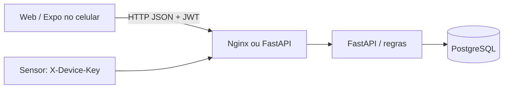

# Smart Parking

<p align="center"><strong>Da procura por uma vaga à decisão de onde estacionar.</strong></p>
<p align="center">Projeto PEX · Faculdade Matias Machline · Manaus, AM</p>

<p align="center">
  
  
  
  
</p>

## Por que este projeto existe?

Imagine chegar a um shopping com pressa. O estacionamento tem vagas, mas você não sabe em qual andar elas estão, quais estão livres nem se a vaga que encontrou atende ao seu veículo. A procura vira voltas desnecessárias. Do outro lado, quem administra o espaço precisa acompanhar ocupação, entradas, saídas e preços sem perder a visão de cada unidade.

O **Smart Parking** conecta esses dois lados. O motorista escolhe um shopping, vê o mapa de vagas atualizado, filtra por tipo, recebe uma sugestão e pode reservar. A equipe acompanha os mesmos eventos no painel, com permissões ligadas ao seu papel e aos seus shoppings. Um simulador por QR e uma API para sensores alimentam a ocupação; relatórios transformam os movimentos das vagas em informação operacional.

| Antes | Com a versão 1 |
|---|---|
| Procurar andar por andar sem saber onde há vaga | Consultar vagas por shopping, andar, tipo e estado |
| Descobrir tarde que a vaga não serve | Filtrar Comum, PCD, Idoso, Moto ou Elétrico antes de escolher |
| Equipe sem uma visão consolidada de uso | Acompanhar ocupação, fluxo, rotação e indicadores financeiros |
| Todos enxergando o mesmo painel | Admin, gestor e financeiro acessam apenas as operações e unidades permitidas |

> **O que a v1 entrega:** frontend Expo para web e dispositivos móveis, API FastAPI, PostgreSQL e Nginx. O PIX é simulado; o Compose é voltado a desenvolvimento e apresentação na rede local. A [especificação da v1](src/docs/SDD.md) distingue recursos implementados de integrações planejadas.

---

## Começar na máquina local

**Requisitos:** Docker com Compose; Node.js 24.19.x e npm 11.17.x para o frontend; celular e computador na mesma rede se usar Expo Go. Execute os comandos a partir da **raiz do repositório**; o frontend não é um serviço do Compose.

```bash
# Terminal 1: constrói e sobe Postgres, API, Nginx e pgAdmin; executa o smoke
./scripts/docker.sh up

# Terminal 2: detecta o IP da máquina, configura a URL mobile e inicia o Expo
./scripts/dev-front.sh
```

| Endereço | O que abre |
|---|---|
| `http://localhost:8081` | Frontend web do Expo, quando servido nessa porta |
| `http://localhost:8000` | API FastAPI direta |
| `http://localhost:8080` | Nginx → API |
| `http://localhost:5050` | pgAdmin |

A URL exata do frontend/QR é mostrada pelo Expo. O app resolve a API automaticamente pelo host do navegador ou pelo IP LAN do Metro; `EXPO_PUBLIC_API_URL_WEB`, `_MOBILE` e `EXPO_PUBLIC_API_URL` no `.env` do frontend são substituições opcionais. `localhost` no celular é o próprio celular. O túnel do Expo transporta o frontend, **não** a porta 8000 do backend.

Na configuração de demonstração, o primeiro boot cria `admin@smartparking.com` com senha `admin123` e popula dados demo se o banco estiver vazio. Essas credenciais e as senhas do Compose são apenas locais. Altere-as antes de qualquer ambiente compartilhado. O smoke usa esse admin padrão; se você já mudou a senha, passe `ADMIN_EMAIL` e `ADMIN_SENHA` ao executá-lo.

### Operação e diagnóstico

```bash
./scripts/docker.sh status                 # estado dos containers
./scripts/docker.sh logs                   # logs de API e Nginx
./scripts/check_conexao.sh                 # frontend, API, rede e CORS
./scripts/docker.sh acesso                 # matriz de acesso por papel
./scripts/docker.sh down                   # para, mantendo o banco
```

Para reconstruir apenas API e Nginx após um `git pull`, sem apagar o banco:

```bash
docker compose -f src/docker-compose.yml up -d --build backend nginx
curl -i http://localhost:8000/api/admin/estacionamentos
```

Sem token, **401** é a resposta esperada para esse GET autenticado; **405** após atualizar o código sugere imagem antiga ou serviço diferente na porta. `docker compose down -v` e `./scripts/docker.sh reset` **apagam os volumes**; não os use para atualizar o código. O frontend deve ser reiniciado com `npx expo start -c` após alterações nas variáveis `EXPO_PUBLIC_*`.

Para abrir o QR do simulador em outro aparelho, defina antes de subir a API: `SIMULADOR_BASE_URL=http://IP_DO_PC:8081`. Configure também o firewall da LAN para permitir as portas necessárias.

## O que cada pessoa pode fazer

| Papel | Acesso principal |
|---|---|
| Visitante | Explorar shoppings, mapa de vagas, sugestão e fluxo público |
| Motorista (`usuario`) | Reservar/cancelar as próprias vagas, consultar histórico de reservas e editar perfil |
| Gestor | Ver relatórios e operar seus shoppings vinculados; pode ter mais de um; não altera preços |
| Financeiro | Ver dados da sua unidade, gerir preços, tarifas, pagamentos/caixa/cupons pela API; vínculo único |
| Admin | Todas as unidades, usuários, sensores e sessões do simulador QR |

O backend aplica o escopo em cada rota; ocultar um botão na interface não concede nem revoga acesso. O painel usa `GET /api/admin/estacionamentos` para listar somente os shoppings permitidos. O motorista pode se autodeclarar PCD no cadastro/perfil; vagas PCD exigem essa declaração para reserva. A disponibilidade e a sugestão são dados da API, não números aleatórios da interface.

## Jornadas da versão 1

1. Na **Início** ou em **Explorar**, escolha um shopping.
2. No **Mapa de vagas**, selecione o andar e filtre por Todas, Comum, PCD, Idoso, Moto ou Elétrico. A grade mostra o tipo e o estado de cada vaga; uma sugestão separada pode recorrer a outro tipo elegível quando não há vaga do tipo solicitado.
3. Entre ou crie uma conta para **reservar**. O cadastro tem veículo opcional e permite voltar ao início. A reserva passa a ocupar a vaga imediatamente; cancelamento e expiração a liberam. Reservas futuras também bloqueiam a vaga desde a criação nesta versão.
4. Em **Minhas reservas**, acompanhe as suas reservas e cancele as confirmadas.
5. No **Painel**, admin/gestor/financeiro consultam seus dados de acordo com o papel. Admin gerencia usuários e gera sessões QR; gestor opera os shoppings vinculados; financeiro controla preços e cobranças pela API.
6. O **simulador** e a rota de **sensor** atualizam vagas, eventos e históricos. Um dispositivo usa `X-Device-Key` e sequência idempotente, sem JWT humano.

Relatórios disponíveis: fluxo, ocupação atual e histórica, rotação e resumo financeiro, incluindo exportações CSV onde implementadas. A interface financeira completa, um gateway real e a instalação física de sensores ficam fora do escopo entregue.

## Como a aplicação se conecta



| Pasta | Responsabilidade |
|---|---|
| `src/frontend/smart-parking/src/app` | Telas e rotas Expo Router |
| `src/frontend/smart-parking/src/components`, `hooks`, `services` | UI, polling/cache, sessão e cliente HTTP |
| `src/backend/api` | HTTP público, autenticação, painel e sensor |
| `src/backend/core`, `rules`, `models` | Segurança/escopo, regras de negócio, banco e schemas |
| `src/backend/migrations` | Revisões Alembic do esquema |
| `src/nginx`, `src/docker-compose.yml` | Proxy, rede e serviços de demonstração |
| `scripts`, `.github/workflows` | Subida, diagnóstico, smoke e CI |

As datas são armazenadas em UTC e relatórios usam `America/Manaus`. O backend mantém um worker porque sessões QR e alguns controles ainda vivem em memória: reiniciar a API invalida os QR ativos. O boot cria tabelas faltantes e repara alguns volumes antigos; alterações futuras de esquema exigem revisão Alembic. Veja [migrações](src/docs/MIGRACOES.md).

## Desenvolvimento e verificação

O CI em [`.github/workflows/ci.yml`](.github/workflows/ci.yml) executa lint/testes backend em Python 3.10/3.12, verificações de dependências e tipos do frontend e jornadas Playwright web com API real. Há também workflow de emulador Android acionável separadamente. Para verificações locais pontuais:

```bash
cd src/backend
pip install -r requirements.txt -r requirements-dev.txt
pytest tests -q

cd ../frontend/smart-parking
npm ci
npm run typecheck
```

As telas foram preparadas para larguras móveis, tablet, desktop e TV; o CI web cobre viewports representativas. Não há garantia de validação física em todos os aparelhos. Se o CI falhar, consulte o job e o cenário específico antes de declarar uma entrega pronta.

## Especificação e limites

- [SDD da versão 1](src/docs/SDD.md): contrato de funcionalidades, permissões, regras, arquitetura, aceite e limites.
- [Mapa da aplicação](src/docs/MAPA_APLICACAO.md): índice técnico e fluxos históricos; em caso de divergência, prevalecem código e SDD v1.
- [Migrações](src/docs/MIGRACOES.md), [conectividade mobile](src/docs/CONECTIVIDADE_MOBILE.md) e [QA de interface](src/docs/QA_UI_UX.md): operação e investigação detalhada.

A v1 não inclui gateway de pagamento real, 3D, câmeras com visão computacional nem integração com sistemas terceiros. As **quatro frentes propostas para a v2**, com critérios iniciais, estão no [SDD §12](src/docs/SDD.md#12-direção-da-versão-2-fora-do-aceite-da-v1). Também permanecem como limites da v1 o PIX simulado, sessões QR em memória, reserva futura com bloqueio imediato, TLS não configurado no Compose e validação física não universal.

**Equipe PEX:** Breno Santos (autor/liderança), Gabriel Almeida (desenvolvimento) e Jonas Almeida (UI).
