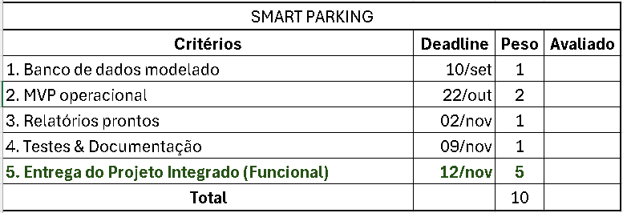

# Marcas de Entrega — SmartParking (PEX)



A tabela da rubrica oficial (total 10 pontos) é a régua do projeto: cada marca
abaixo diz **o que já está provado no repositório** e **o que falta** para a
banca fechar o ponto. Atualizar o "Status" a cada revisão.

| # | Critério         | Deadline | Peso | Status                          |
| - | ---------------- | -------- | ---- | ------------------------------- |
| 1 | Banco modelado   | 10/09    | 1    | ✅ Entregue                     |
| 2 | MVP operacional  | 22/10    | 2    | ✅ **Entregue 20/10** (+ auditoria de acesso) |
| 3 | Relatórios       | 02/11    | 1    | ✅ **Entregue 22/10** (back+CSV+aba no painel) |
| 4 | Testes & Docs    | 09/11    | 1    | ✅ **Entregue 22/10** (31 testes, CI, SDD v0.2, Alembic baseline) |
| 5 | Entrega Integrada| 12/11    | 5    | 🟡 Chave de sensor ✅ 22/10; sessões-Postgres/câmera/TLS abaixo |

---

## 1️⃣ Banco de dados modelado — 10/09 · peso 1 ✅

Modelagem completa em `src/backend/models/db_models.py` — **10 tabelas, 47
relacionamentos/FKs, 31 campos indexados** (SQLAlchemy + Postgres 15):

| Tabela                 | Papel no domínio                                                        |
| ---------------------- | ----------------------------------------------------------------------- |
| `usuarios`             | Motorista / Gestor / Financeiro / Admin — roles, credenciais, bloqueio  |
| `estacionamentos`      | Filiais: endereço, horários, taxa base, capacidade                       |
| `andares`              | Planta por filial (aceita subsolo negativo)                               |
| `vagas`                | Vaga física com estado (livre/ocupada/manutenção/reservada)              |
| `reservas`             | Ciclo entrada→saída: placa, valores, QR de vínculo                        |
| `configuracoes_precos` | Tarifação por andar/tipo de vaga                                          |
| `historicos`           | Auditoria automática de entrada/saída/alteração                           |
| `cupons_desconto`      | Campanhas com validade e limite de uso                                    |
| `pagamentos`           | Fluxo financeiro (método, valor, estorno)                                 |
| `fechamentos_caixa`    | Fechamento diário por filial                                              |

Extras que contam a favor: criação de schema automática no boot
(`Base.metadata.create_all`), **seed demo** idempotético (`seed_demo.py`,
8 shoppings de Manaus) e fallback SQLite só em dev (desligável com
`DB_AUTO_SQLITE=false` — o compose de produção já liga o modo estrito).

## 2️⃣ MVP operacional — 22/10 · peso 2 🎯 (esta entrega)

MVP "operacional" = cadeia inteira **reproduzível em qualquer máquina**. Desta
entrega:

- **Conserto da cadeia Docker→Nginx→API** (estava quebrada em 4 pontos — 502
  por bind `localhost` do gunicorn, conf do nginx instalado em lugar morto,
  zonas de rate limit inexistentes, `400 Invalid host header` em produção):
  `src/nginx/Dockerfile`, `src/nginx/default.conf`, `src/backend/gunicorn_config.py`,
  `src/docker-compose.yml`.
- **Rota `GET /health`** + healthcheck real no compose (nginx só sobe com a API viva).
- **`TRUSTED_HOSTS` configurável** (era hardcoded localhost-only; a banca por IP
  da LAN não funcionaria em produção).
- **`scripts/smoke_mvp.sh`** (10 checagens): prova a cadeia em 1 comando — e não
  aceita "201 vazio": grava estacionamento→subsolo→lote G01..G03 e exige que
  **G01 e a taxa voltem na leitura** (foi assim que a auditoria achou payload com
  nomes de campo errados sendo engolido pelo schema).
- **`scripts/smoke_acesso.sh`** (27 checagens): matriz rota × perfil com cenário
  próprio (2 estacionamentos QA + gestor/financeiro/motorista, apagado no fim).
  Achados JÁ corrigidos aqui: `PATCH /api/vagas/{id}/status` e do lote eram
  **públicos** → exigem admin/gestor com escopo `vaga→andar→estacionamento`;
  `GET /api/relatorios/fluxo` expunha `registros[]` (valores/placas) a qualquer
  um → papel de painel + rota nova `/relatorios/fluxo/publico` só agregados p/
  Home; `DELETE` de estacionamento/andar/vaga com histórico quebrava em
  `IntegrityError` (SQLAlchemy nullifica FK NOT NULL) → purge
  pagamentos→históricos→reservas antes do delete.
- **`scripts/docker.sh`**: `up` (re)gera as imagens do zero (cenário "deletei o
  docker"), `reset` = volume limpo p/ demo, `logs`/`status`/`acesso` p/ diagnóstico.

**Como validar em 2 minutos:**

```bash
./scripts/docker.sh up                            # rebuild do zero + smoke na API
BASE_URL=http://localhost ./scripts/smoke_mvp.sh  # idem via nginx (cadeia completa)
./scripts/docker.sh acesso                        # 27 checagens de controle de acesso
BASE_URL=http://localhost ./scripts/smoke_acesso.sh  # ...agora através do nginx
```

**Checklist do dia 22 (rodar na véspera na máquina da apresentação):**
banco limpo (`docker compose down -v && up -d --build`) → login `admin@smartparking.com/admin123`
→ painel: novo estacionamento + andares + vagas em lote → criar usuário gestor →
celular no mesmo Wi-Fi: `npx expo start` (`.env` com `EXPO_PUBLIC_API_URL=http://<IP-da-máquina>:8000`)
→ cadastro motorista → explorar → reservar → entrar com QR → saída.
Se travar em algo "sem dados", seguir as Achas de configuração do README.

## 3️⃣ Relatórios prontos — 02/11 · peso 1 ✅ (entregue 22/10)

Backend **completo** em `rules/relatorio_service.py` + `financeiro_service.py` e rotas em `api/api.py`:

- `GET /api/relatorios/fluxo` — entradas/saídas/permanência, fuso **America/Manaus** na borda
  (datas chegam como D-nacional→janela UTC-4, ADR-05);
- `GET /api/relatorios/ocupacao` — instantâneo + heatmap, **denominador sem `inativa`** (RN-10);
- `GET /api/relatorios/ocupacao-historica` — **derivado do `Historico`**, sobreposição de estadias
  por hora local × andar (ADR-09, substitui o snapshot gravado a cada 5 min — nunca existiu);
- `GET /api/relatorios/rotacao` — entradas, giro e tempo médio por andar;
- `GET /api/relatorios/financeiro/resumo` + `GET /api/admin/financeiro/resumo` — receita por dia,
  por método (cartão = crédito+débito), ticket médio, por tipo de vaga;
- `GET /api/relatorios/fluxo/csv` e `/financeiro/csv` — `StreamingResponse`-free (CSV simples),
  com BOM + `;` para abrir certinho no Excel pt-BR;
- **Gating real**: as rotas exigem papel de painel E `garantir_escopo_relatorio` (gestor/financeiro
  só no próprio estacionamento — 403 fora; motorista 403), e rate limit `relatorios` por usuário;
- **Aba "Relatórios" no painel** (`src/app/dashboard.tsx`): pills de período, cards de fluxo,
  heat 24×andares, rotação, financeiro com barra por dia e **dois botões de CSV**
  (`parkingApi.baixarCsv` — download no web, orientação de painel no nativo).

Testes: `tests/test_relatorios.py` + `test_financeiro.py` + `test_escopo_api.py` cobrem fuso,
denominador, heat, giro, cartão P16 e a matriz BOLA dos CSVs.

## 4️⃣ Testes & Documentação — 09/11 · peso 1 🟡

- **pytest (✅ 31 testes, roda sem Docker):** `src/backend/tests/` com `TestClient` + SQLite
  isolado (`.pytest_smartparking.db`, criado pelo `conftest.py` ANTES do import do app).
  Grupos: timeutils/guards (produção recusa chave padrão, flag social, chave do limiter),
  relatórios (fuso, denominador, heat, giro), reserva/vaga (RF-23/25, lote ACH-17),
  financeiro (tarifa RN-05/06, cupom, P16), **sessões** (logout revoga access+refresh,
  compat com token pré-jti, perfil, reset do admin), **sensores** (chave, idempotência,
  revogação) e a matriz BOLA/401/403. Rodar: `cd src/backend && pytest tests -q`.
- **Alembic (✅ M4-02):** baseline `3c79cee6fe1f` gerada dos modelos (13 tabelas),
  `upgrade head` + `alembic check` validados em banco limpo; fluxo de *stamp* para os
  bancos já existentes em `src/docs/MIGRACOES.md`.
- **CI (✅):** `.github/workflows/ci.yml` roda `pytest` (py 3.12) e `tsc --noEmit` (node 24 +
  `NPM_CONFIG_ENGINE_STRICT=false`) a cada push/PR — M4-01/ADR-10 fechado.
- **Docs (✅ desta rodada):** SDD completo em `src/docs/SDD.md` com status ✅/⬜ por item e
  log de evidências; README com bloco pytest + roadmap = rubrica; `DOCUMENTACAO_BACKEND.md`
  desmentido (1 worker, sensores autenticados, contagem de rotas); notas de honestidade
  (M4-04/ADR-15) no topo de `PROTECAO_REQUISICOES.md` e `SEGURANCA_TLS_WIRESHARK.md`
  (HMAC = atrito, pinning NÃO implementado, compose é HTTP puro).
- **Aceite E2E (✅):** `smoke_mvp.sh` (10/10) + `smoke_acesso.sh` (27/27) contra o backend
  com o código novo; `validar_frontend.sh` (tsc+export web).
- **Falta para o ✅:** E2E de UI (Detox/Maestro) se a banca exigir, e os itens da marca 5
  que mordem docs (sessões em Postgres → reescrever §H-01 dos docs de segurança).

## 5️⃣ Entrega do Projeto Integrado (Funcional) — 12/11 · peso 5 ⬜

Fecha o sistema inteiro funcionando de ponta a ponta (mobile + web + painel +
relatórios + testes). Andamento em 22/10: **chave de dispositivo + ingestão idempotente
de sensores (RF-45/ADR-03) ✅**, edições de cadastro do painel (RF-31..34) ✅, sessão com
revogação real (RF-13) ✅, perfil/recuperação (RF-14/15) ✅ e cache offline persistido
(RF-06) ✅. Hardening que resta:

- `ENVIRONMENT=production` de verdade: TLS no nginx (guia em
  `SEGURANCA_TLS_WIRESHARK.md`), `TRUSTED_HOSTS` com o domínio, `SECRET_KEY` e
  `APP_SIGNING_SECRET` fortes (a chave de assinatura precisa ser **a mesma** no
  app — paridade documentada em `requestSigner.ts`);
- **Migrar sessões do simulador/QR e o cache anti-replay para o banco/Redis** →
  libera `GUNICORN_WORKERS>1` (hoje travado em 1 por estado em memória — ver
  comentário em `gunicorn_config.py`);
- Backup do volume Postgres (`pg_dump` agendado) + rotina de restore documentada;
- Leitura do **QR pela câmera** do celular no check-in/check-out (entrada/saída reais);
- Manual do usuário com prints + roteiro de apresentação.

---

*Legenda de status: ✅ entregue/comprovado · 🎯 foco do prazo atual · ⬜ planejado · ⚠️ parcial.*
*Preencher a coluna "Avaliado" da tabela da rubrica com a data da revisão do professor.*
