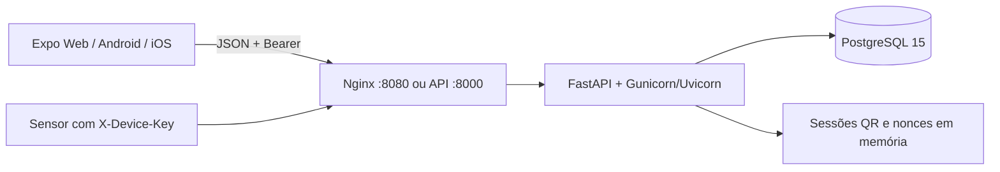

# SDD — Smart Parking, versão 1

| Campo | Definição |
|---|---|
| Projeto | `smart-parking-pex`, projeto PEX da Faculdade Matias Machline, Manaus/AM |
| Documento | Software Design Document (SDD), contrato funcional e técnico da versão 1 |
| Revisão | 1.0 — 16/11/2026; base: `main` após correção do filtro e dos alvos de toque (`a9f390f`) |
| Equipe | Breno Santos, Gabriel Almeida e Jonas Almeida |
| Fonte da verdade | Código em `src/backend/`, `src/frontend/smart-parking/`, `src/nginx/`, `src/docker-compose.yml` e scripts versionados |

Este documento descreve a implementação observada no repositório. **Implementado** significa presente no código; não significa que foi verificado em todo aparelho ou ambiente. A seção 10 separa verificações automatizadas, observação de execução e limites. Mudanças posteriores no código exigem atualizar esta revisão.

## 1. Problema, objetivo e escopo

O Smart Parking permite encontrar vagas em estacionamentos de shoppings, acompanhar sua disponibilidade por andar e reservar uma vaga. Uma equipe autorizada gerencia unidades, vagas e relatórios. Um simulador e uma rota de ingestão de sensores alimentam as alterações de ocupação.

A versão 1 inclui consulta pública, cadastro e autenticação, reserva e cancelamento, painel de administração/gestão, relatórios, configuração financeira por API, simulador QR e ingestão por chave de dispositivo. A cobrança PIX é **simulada**; a interface não oferece o fluxo financeiro completo. Não há integração comprovada com sensores físicos, gateway de pagamento, câmera para check-in, push, publicação nas lojas nem implantação pública com TLS.

### 1.1 Termos e dados

| Termo | Significado |
|---|---|
| Estacionamento | Unidade de um shopping, com andares e preços próprios |
| Vaga | Posição de um andar; tipo `comum`, `pcd`, `idoso`, `moto` ou `eletrico`; status `livre`, `ocupada`, `reservada` ou `inativa` |
| Reserva | Direito de um motorista a uma vaga por intervalo; estado `confirmada`, `cancelada`, `concluida` ou `expirada` |
| Histórico | Estadia aberta na entrada e encerrada na saída, base dos relatórios de fluxo |
| Escopo | Conjunto de estacionamentos que um papel de painel pode consultar ou operar |
| Sessão QR | Token temporário do simulador, mantido em memória do único processo backend |

## 2. Usuários e autorização

O backend é a barreira de acesso. O frontend oculta ações conforme o papel, mas uma requisição direta também passa pelas dependências em `core/deps.py` e pelo escopo em `core/escopo.py`.

| Capacidade | Visitante | Motorista (`usuario`) | Gestor | Financeiro | Admin |
|---|---|---|---|---|---|
| Vitrine, mapa, sugestão e fluxo público | Sim | Sim | Apenas unidades vinculadas quando autenticado | Sua unidade quando autenticado | Todas |
| Reservar, cancelar e consultar as próprias reservas | Não | Sim | Não | Não | Sim pelas dependências de motorista; cancelamento exige propriedade |
| Ver dashboard, eventos e relatórios do painel | Não | Não | Unidades vinculadas | Sua unidade | Todas |
| Editar estacionamento, andares e vagas; operar status | Não | Não | Unidades vinculadas, sem alterar `taxa_hora` | Não | Todas |
| Criar/excluir estacionamento, andar ou vaga; administrar usuários | Não | Não | Não | Não | Sim |
| Ver preços, pagamentos, caixa e cupons | Não | Não | Unidades vinculadas | Sua unidade | Todas |
| Configurar preços, calcular/cobrar, caixa e cupons | Não | Não | Não | Sua unidade | Todas |
| Criar/revogar sensor e sessão do simulador QR | Não | Não | Não | Não | Sim |

O gestor pode ter vários vínculos em `usuario_estacionamentos`; o financeiro fica limitado ao vínculo principal e a regra de usuários limita uma conta financeira por unidade. Sem seleção explícita, uma operação de gestor/financeiro usa o vínculo principal, nunca um agregado global. Um ID de outra unidade retorna 403. O admin pode usar o agregado de todas as unidades onde a rota o permite. A emissão de PIX também aceita o motorista proprietário da estadia; gestor não cobra. Fonte: `core/escopo.py`, `api/api.py`, `api/admin.py`, `rules/admin_service.py`.

## 3. Jornadas da interface

| Tela/rota Expo | Jornada e estado principal | Serviço/rota HTTP |
|---|---|---|
| `/` | Escolher shopping e abrir vagas; estado vazio e atualização | `GET /api/estacionamentos` |
| `/explorar` | Buscar shopping por nome/endereço | Lista pública, filtro no cliente |
| `/shopping/[id]` | Andar, status, filtro `Todas/Comum/PCD/Idoso/Moto/Elétrico`, sugestão, reserva/cancelamento | `GET /api/estacionamentos/{id}/vagas`, `.../proxima-vaga`, reservas |
| `/cadastro` | Duas etapas, veículo opcional, autodeclaração PCD, voltar ao início, login após criar | `POST /auth/registrar`, `/auth/login` |
| `/login` e `/perfil` | Acesso, sessão, dados pessoais, senha e saída | `/auth/login`, `/auth/me`, `/auth/senha`, `/auth/logout` |
| `/reservas` | Histórico das reservas próprias e cancelamento permitido | `GET /api/reservas/minhas`, `DELETE /api/reservas/{id}` |
| `/dashboard` | KPIs, seletor por escopo, unidades, andares/vagas, relatórios e usuários conforme papel | `/api/admin/*`, `/api/relatorios/*` |
| `/simulador-qr`, `/simulador` | Admin cria/revoga QR; sessão tokenizada abre operação de vagas no aparelho | `/api/admin/simulador/sessoes`, `/api/vagas/*` |

O frontend é Expo Router, React Native e NativeWind. Web e mobile compartilham a navegação; o painel usa barra lateral em larguras a partir de 1024 px e navegação adaptada abaixo disso. `useLarguraResponsiva`, receitas em `styles/recipes.ts`, áreas seguras, rolagem e componentes comuns dão suporte aos tamanhos de tela. Existe automação de UI web no CI; não há evidência de validação física para toda TV, tablet, celular e orientação.

## 4. Requisitos e regras da versão 1

| ID | Contrato | Situação e fonte |
|---|---|---|
| RF-01 | Consultar shoppings, mapa, andares, disponibilidade e sugestão | Implementado: `api/api.py`, `rules/estacionamento_service.py`, `shopping/[id].tsx` |
| RF-02 | Buscar e filtrar por tipo de vaga, inclusive `comum`, na web e no celular | Implementado no frontend: `explorar.tsx`, `shopping/[id].tsx` |
| RF-03 | Cadastro, login, refresh, logout com revogação, perfil e troca de senha | Implementado: `api/auth.py`, `AuthContext`, `services/api.ts` |
| RF-04 | Reservar, cancelar e listar reservas próprias | Implementado: `rules/reserva_service.py`, `api/api.py`, telas de mapa/reservas |
| RF-05 | Expirar reservas vencidas e concluir a reserva ao ocupar a vaga | Implementado: varredura na leitura e no lifespan de 60 s; `rules/reserva_service.py`, `rules/vaga_service.py` |
| RF-06 | CRUD de unidades, andares/vagas e gestão de usuários segundo papel | Implementado: `api/admin.py`, `rules/admin_service.py`, `dashboard.tsx` |
| RF-07 | Relatórios de fluxo, ocupação atual/histórica, rotação e financeiro; CSV | Implementado: `api/api.py`, `api/admin.py`, `rules/relatorio_service.py`, `rules/financeiro_service.py` |
| RF-08 | Preços, tarifa, pagamentos presenciais/PIX simulado, caixa e cupons | Implementado por API: `api/admin.py`, `rules/pagamento_service.py`; UI financeira completa fora da v1 |
| RF-09 | Simulador QR com expiração/revogação; atualização de vaga e eventos | Implementado com sessão em memória: `rules/simulador_service.py`, `api/admin.py` |
| RF-10 | Ingestão de sensor por `X-Device-Key` com sequência idempotente | Implementado por API: `api/sensores.py`, `rules/sensor_service.py`; dispositivo físico não validado |
| RF-11 | Acesso isolado por papel e unidade, inclusive na leitura autenticada da vitrine | Implementado: `core/deps.py`, `core/escopo.py`, `tests/test_matriz_papeis.py` e `test_vinculos_shopping.py` |
| RF-12 | Última leitura em cache, feedback de erro/carregamento e reconexão | Implementado no cliente: hooks e componentes; cache não é fonte transacional |

### 4.1 Invariantes

1. `reservar` exige vaga livre; a reserva muda seu status para `reservada` imediatamente, mesmo que o início seja futuro. Só o proprietário cancela; se a vaga ainda está reservada, o cancelamento libera. Reservas vencidas mudam para `expirada`.
2. Vaga PCD só pode ser reservada por conta com `is_pcd=true`; o motor não atribui PCD a anônimo/não declarado. Para declarado, prioriza PCD quando disponível. A declaração é editável no cadastro/perfil.
3. Mudança `livre → ocupada` abre histórico e `ocupada → livre` encerra a estadia; uma reserva ocupada é concluída. O histórico sustenta métricas por período.
4. O tipo de vaga pode ser `comum`, `idoso`, `pcd`, `moto` ou `eletrico`; o filtro do mapa compara o tipo real da vaga. A sugestão de próxima vaga prioriza o tipo pedido e pode recorrer a outra vaga elegível quando não houver do tipo.
5. Preço/cupom/caixa/pagamento são escopados pela unidade. A tarifa considera tolerância, fração/hora, diária, mínimo e desconto; calcular não consome cupom. Caixa aberto é único por estacionamento.
6. Relatórios interpretam o período em `America/Manaus` e persistem datas em UTC. Ocupação não usa vagas `inativa` no denominador. Ocupação histórica é derivada das estadias, sem snapshots próprios.
7. Uma chave revogada não autoriza novos eventos de sensor; retransmissão `(sensor, seq)` não duplica a transição. QR expira em 1–48 horas ou é revogado manualmente.

### 4.2 Evolução em desenvolvimento na versão 1 — usuários, veículos e vagas especiais

**Situação: planejada para conclusão da V1, não implementada integralmente.** A funcionalidade atual utiliza `usuarios.is_pcd` como autodeclaração, e as vagas existentes são `comum`, `idoso`, `pcd`, `moto` e `eletrico`. A evolução abaixo deve integrar a própria versão 1, sem ser classificada como V2 nem descrita como pronta.

| ID | Requisito V1 | Critério de aceite |
|---|---|---|
| RF-13 | Perfil do usuário com data de nascimento e indicação de benefício especial | Cadastro básico continua rápido; idade calculada no backend; informar 60+ não concede automaticamente acesso a vaga de idoso |
| RF-14 | Garagem com múltiplos veículos por conta | Cadastrar/editar/excluir carro ou moto, placa normalizada e motorização combustão/híbrido/elétrico; diferenciar carro elétrico de moto elétrica |
| RF-15 | Verificação de credencial de idoso/PCD | Solicitação sob demanda; estados pendente/aprovada/rejeitada/vencida/revogada; análise por responsável autorizado com registro de decisão e validade; beneficiário pode ser motorista ou passageiro |
| RF-16 | Elegibilidade de vaga verificada no backend | Avaliar tipo da vaga, veículo, motorização e eventual carregador, credencial e regras do beneficiário antes da confirmação de reserva; negar com mensagem explicativa quando incompatível |
| RF-17 | Interface mobile/web de veículos e credenciais | Acesso por perfil, seleção do veículo na reserva, consulta da situação de validação e fluxo comum sem exigência de documentos especiais |
| RF-18 | Segurança e privacidade das credenciais | Coleta mínima de documentos, acesso restrito, histórico de decisões e política de retenção; sem reconhecimento facial ou estimativa de idade como comprovação automática |

**Modelo técnico da V1:** separar `vehicles` (pertencentes ao usuário, tipo, placa e motorização), `parking_credentials` (beneficiário, espécie, validade e estado da avaliação) e um serviço `parking_eligibility` para autorização transacional. Adaptar as referências de reserva quando necessário. Migrar o esquema com Alembic, atualizar contratos de API, testes de concorrência, autorização e mensagens de erro. A conferência automatizada por fonte oficial só deverá ser adicionada caso exista integração viável e autorizada; a simples leitura de imagem/QR não substitui verificação.

**Sequência da V1:** (1) modelos, migrações e CRUD de veículos; (2) credenciais e revisão administrativa; (3) regras de elegibilidade e integração com reserva; (4) telas e testes de fluxo ponta a ponta. Preservar a autorização para vagas comuns durante todo o processo. A autodeclaração PCD vigente exige transição controlada, sem conceder privilégios como se já houvesse comprovação.

## 5. Arquitetura e dados



O frontend resolve a URL em `services/apiBaseUrl.ts`: variável específica web/mobile, variável global, host do navegador no web, host do Metro no nativo e `10.0.2.2` no emulador Android. `services/api.ts` centraliza o Bearer, refresh e assinatura das escritas. Em caso de 401, o cliente tenta refresh único e reconduz ao login quando a sessão não pode ser restaurada.

No backend, `main.py` compõe `api/api.py` (vitrine, reservas, status e relatórios), `api/auth.py`, `api/admin.py` e `api/sensores.py`. `core/` contém autenticação, escopo, CORS, limites e middleware; `rules/` contém operações de negócio; `models/` contém ORM e contratos Pydantic. `rules/` usa SQLAlchemy e algumas `HTTPException`, portanto não é independente do framework. A resposta JSON é modelada em `models/schemas.py`.

| Grupo de tabelas | Tabelas do ORM | Relação central |
|---|---|---|
| Acesso | `usuarios`, `usuario_estacionamentos`, `revogacoes_token` | Usuário tem papel, vínculo principal e vínculos adicionais do gestor; token pode ser revogado |
| Operação | `estacionamentos`, `andares`, `vagas`, `reservas`, `historicos` | Unidade → andares → vagas; reserva aponta para motorista/vaga; histórico registra entrada/saída |
| Financeiro | `configuracoes_precos`, `cupons_desconto`, `fechamentos_caixa`, `pagamentos` | Preço e caixa por unidade; pagamento relaciona estadia |
| Dispositivos | `sensores`, `sensor_eventos` | Chave armazenada como hash; evento único por sensor e sequência |

Nomes exatos das tabelas e chaves ficam em `models/db_models.py`. Existem revisões Alembic para o baseline, `usuarios.is_pcd` e vínculos múltiplos. `main.py` ainda executa `create_all` e reparos idempotentes limitados para volumes antigos. Isso **não substitui** aplicar e revisar migrações de futuras mudanças de esquema; ver `MIGRACOES.md`.

## 6. Contratos HTTP e erros

| Prefixo | Uso | Autorização |
|---|---|---|
| `/health`, `/api/health` | Processo e consulta de banco, respectivamente | Pública; `/health` não comprova que o DB atende |
| `/api/estacionamentos`, `/api/estacionamentos/{id}/vagas`, `.../proxima-vaga` | Vitrine, mapa, sugestão | Pública, mas restringe gestor/financeiro autenticado ao seu escopo |
| `/auth/*` | Cadastro, login, refresh, logout, perfil, senha | Credenciais ou Bearer conforme rota; login social desligado por padrão |
| `/api/reservas*` | Reserva e histórico pessoal | Motorista/admin; propriedade validada para cancelar |
| `/api/admin/*` | Painel, CRUD, finanças e simulador | Dependências por papel e validação da unidade |
| `/api/relatorios/*` | Agregados e CSV | Público apenas em `/fluxo/publico`; demais por papel/escopo |
| `/api/sensores/eventos` | Ingestão em lote | Chave `X-Device-Key` emitida/revogada pelo admin |

A forma usual de erro é `{"detail": "..."}`. `401` exige autenticação válida; `403` indica papel, propriedade ou escopo insuficiente; `404` indica recurso não encontrado; `405` indica método incompatível com a rota; `429` indica limite. Em particular, `GET /api/admin/estacionamentos` **existe** no backend atual: sem Bearer deve responder 401, e com papel de painel válido lista só as unidades permitidas. `scripts/smoke_mvp.sh` cobre esse contrato para detectar uma imagem Docker antiga que só responde ao POST.

## 7. Segurança e decisões

| Decisão | Implementação e limite |
|---|---|
| Identidade | JWT de acesso/refresh, senha com hash, revogação de sessão e checagem de usuário ativo; senha temporária é gerada por admin para recuperação presencial |
| Autorização | Papel no backend + escopo por ID de unidade; controles da interface são conveniência, não barreira |
| Dispositivo | `X-Device-Key` com hash persistido e idempotência; não reutiliza o JWT humano |
| Escrita em produção | Assinatura HMAC com timestamp/nonce e path incluindo query; segredo no bundle web **não é segredo confiável** e HMAC não substitui HTTPS/controle de acesso |
| Perímetro | Limite de corpo, rate limit, CORS, headers, filtro de host em produção; Nginx tem limites de requisição e de login |
| Segredos e deploy | O Compose versionado está em `staging`, com senhas de demonstração e portas expostas; não é perfil pronto de produção. Produção exige segredos próprios, CORS/hosts explícitos e terminação TLS |

Decisões mantidas: polling em vez de WebSocket; um worker enquanto estado QR/anti-replay está em memória; UTC no banco e `America/Manaus` na interface de relatórios; Alembic como histórico de esquema junto ao reparo limitado de compatibilidade. Um reinício do backend invalida sessões QR em memória. Escalar workers exige mover esse estado para armazenamento compartilhado.

## 8. Implantação e operação

`src/docker-compose.yml` define PostgreSQL 15 (`5432`, volume persistente), backend (`8000`, um worker, healthcheck TCP), Nginx (`8080` no host → `80` no container) e pgAdmin (`5050`). Nginx encaminha à API; o frontend Expo é executado **fora** desse Compose. O healthcheck TCP sinaliza processo aceitando conexão, não garante que cada rota/consulta esteja correta.

Da raiz do repositório:

```bash
./scripts/docker.sh up
npm --prefix src/frontend/smart-parking ci
./scripts/dev-front.sh
```

O primeiro comando recria as imagens e executa o smoke do MVP; `npm ci` instala as dependências do frontend; o último atualiza a URL mobile da API pela LAN e inicia Expo com cache limpo. Execute backend e Expo em terminais separados. Para subir somente serviços sem smoke: `docker compose -f src/docker-compose.yml up -d --build backend nginx`; para conferir: `docker compose -f src/docker-compose.yml ps`, `curl -i http://localhost:8000/api/admin/estacionamentos` (esperado 401 sem token) e `curl -i http://localhost:8080/api/health` (esperado 200 com banco funcional). `docker compose down` mantém volumes; `down -v` apaga os dados.

Uma imagem antiga pode continuar saudável e responder `405` em uma rota nova. Após atualizar o `main`, é necessário reconstruir o backend. QR aberto em outro aparelho exige `SIMULADOR_BASE_URL=http://IP_DO_PC:8081` no ambiente antes de subir o Compose. `localhost` dentro do celular refere-se ao próprio aparelho.

## 9. Qualidade e critérios de aceitação

| Área | Evidência versionada | Critério para aceitar a v1 |
|---|---|---|
| Backend | `tests/`, `ruff`, jobs Python 3.10/3.12 em `.github/workflows/ci.yml` | Rotas, regras, escopo e persistência passam sem regressão |
| Frontend | Typecheck, Expo Doctor/SDK e testes Playwright web com API real no CI | Navegação e interações principais funcionam sem erro de runtime |
| Integração local | `scripts/smoke_mvp.sh`, `scripts/smoke_acesso.sh`, `scripts/check_conexao.sh` | Login, GET do painel, reserva e acesso por papel coerentes com o código |
| Compatibilidade | `scripts/validate_expo_native.sh`, workflow de emulador Android | Configuração nativa conferida; validação de hardware físico ainda é separada |
| Visual | `tests/ui/`, prévias de CI e revisão manual | Sem cortes, sobreposição e rolagem quebrada nas telas de entrada, mapa, reserva e painel em larguras representativas |

Este SDD foi fechado por **auditoria do código**, não por uma nova rodada completa de testes ou medição de latência. O usuário observou a reconstrução dos containers e `GET /api/admin/estacionamentos → 401` sem token em 16/11/2026. A execução autenticada e a inspeção física em TV, notebook, tablet e celular não foram observadas nesta revisão documental. Não declarar metas de p95, cobertura percentual ou compatibilidade universal como resultados medidos.

## 10. Limites conhecidos e trabalho fora da versão 1

| Item | Consequência / decisão |
|---|---|
| Reserva futura bloqueia a vaga assim que é criada | Planejamento de intervalos sem bloqueio antecipado requer outro modelo de disponibilidade |
| Sugestão pode recorrer a tipo elegível diferente do solicitado | O mapa filtrado mostra só o tipo selecionado; a sugestão é uma recomendação separada |
| Sessões QR e alguns controles vivem em memória | Reinício invalida QR; múltiplos workers não são suportados sem estado compartilhado |
| PIX e pagamento | API simula PIX; não há cobrança bancária real nem UI financeira de ponta a ponta |
| Câmera e sensores físicos | Check-in pela câmera não implementado; protocolo de sensor existe, instalação física não validada |
| Produção pública | Compose é staging; TLS, segredos, domínio/hosts, persistência operacional e hardening exigem implantação própria |
| Migrações | Reparo do boot cobre só casos conhecidos; aplicar Alembic ao mudar esquema é responsabilidade de operação |
| Plataformas | CI web/emulador não equivale à revisão visual e funcional em todos os dispositivos possíveis |

## 11. Rastreabilidade e manutenção do SDD

| Se mudar... | Atualizar código e documentação de... |
|---|---|
| Papel, permissão ou vínculo | `core/deps.py`, `core/escopo.py`, rotas, testes de matriz e §2/§6 deste SDD |
| Endpoint ou resposta | `api/`, `models/schemas.py`, `services/api.ts`, smoke e §3/§6 |
| Regra de vaga, reserva ou preço | `rules/`, testes correspondentes e §4 |
| Tabela ou relacionamento | `models/db_models.py`, revisão Alembic, `MIGRACOES.md` e §5 |
| Ambiente, porta ou segredo | Compose/Nginx/scripts, exemplos de `.env`, README e §7/§8 |
| Tela ou breakpoint | Expo, testes UI, README e §3/§9 |

Referências complementares: `MIGRACOES.md`, `INTEGRACAO_FRONTEND.md`, `QA_UI_UX.md` e `MARCAS_ENTREGA.md` preservam detalhes operacionais e históricos. Em caso de divergência, conferir o código e corrigir a documentação; os registros antigos de 22/10 permanecem no histórico Git do SDD, não como especificação vigente.

## 12. Direção da versão 2 (fora do aceite da v1)

O produto tem **quatro** frentes propostas para a próxima versão. Nenhuma é declarada como pronta por este SDD. Antes da implementação, cada frente precisa de contrato de dados, tratamento de falhas, autorização e evidência de operação.

| ID | Frente | Contrato inicial e critério de aceite proposto |
|---|---|---|
| V2-01 | API/gateway de pagamento | Integrar um provedor real em ambiente de teste e produção; criar intenção com chave idempotente, receber e verificar confirmação assíncrona, conciliar valor/estadia, registrar estorno e tratar indisponibilidade sem marcar como pago antes da confirmação. Nunca expor credenciais do gateway no app. |
| V2-02 | Modelo 3D simulado do estacionamento | Representar unidade → andar → vaga e estado a partir dos IDs atuais; sincronizar com a mesma API do mapa 2D; preservar uma alternativa 2D acessível e desempenho aceitável nos dispositivos alvo. A representação não deve inventar ocupação. |
| V2-03 | Sensores com visão computacional e câmeras inteligentes | Criar serviço de inferência que associa detecção a vaga/câmera, indica confiança e publica transições idempotentes; prever calibração, revisão humana de ambiguidade e tratamento de câmera offline. Validar privacidade, retenção e segurança das imagens antes de implantação real. |
| V2-04 | Integração com sistemas de gerenciamento de estacionamento | Definir adaptadores por fornecedor, identidade externa ↔ IDs internos, autenticação, sincronização inicial/incremental, reconciliação de conflitos e observabilidade. O sistema de origem e a direção de cada dado devem ser definidos por integração. |

Ordem técnica sugerida: estabilizar contratos de eventos/identidades e observabilidade, integrar pagamentos e sistemas externos por adaptadores, então conectar visão computacional e a visualização 3D aos mesmos estados consolidados. Essa ordem é uma proposta de planejamento, não uma promessa de prazo ou decisão sobre fornecedores.
