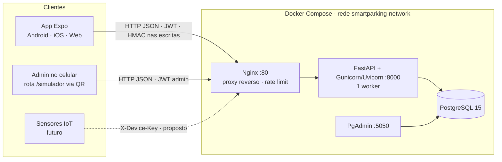
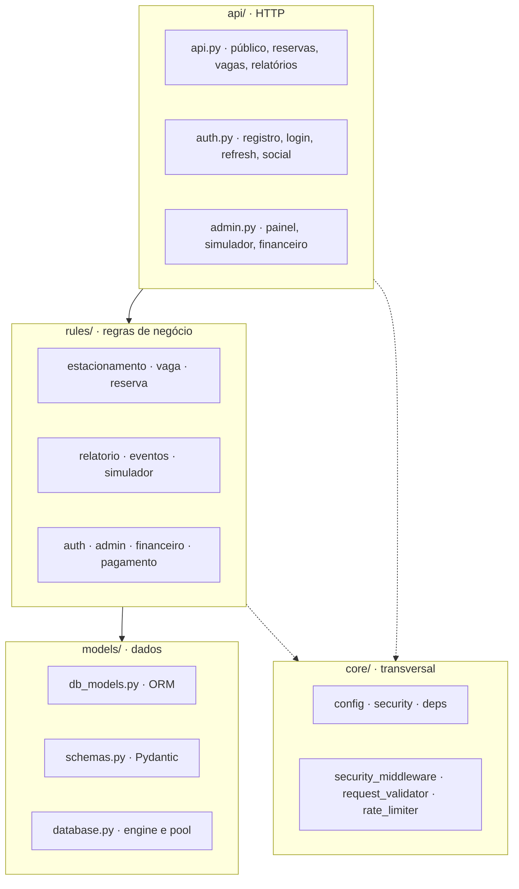
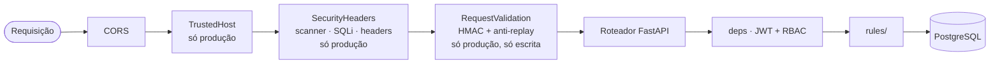

# SDD — Smart Parking · Monitoramento Inteligente de Vagas

| Campo | Valor |
|---|---|
| Projeto | `smart-parking-pex` (InteliParking) — extensão PEX, FMM, Manaus/AM |
| Tipo de documento | SDD: *Software Design Document* e especificação executável (*Spec-Driven*) |
| Versão | **0.2 — aprovada pelo autor (22/10) e em execução; itens ✅ com evidência no apêndice §12** |
| Data | 22/10/2026 |
| Equipe | Breno Santos (autor, liderança, desenvolvimento) · Gabriel Almeida (desenvolvimento) · Jonas Almeida (UI) |
| Base de análise | Leitura do repositório: backend, frontend, nginx, docker, scripts e `src/docs/` |
| Não analisado | Arquivo do Figma (sem link), `PLANO_DO_PROJETO.md`, `VALIDACAO_E_CONFORMIDADE.md` e `scripts/validacao/*` (não enviados) |
| Substitui (após aprovação) | `CLAUDE.md` (briefing de 12/10) como fonte da verdade |
| Documentos irmãos | `MAPA_APLICACAO.md` (mapa do sistema + fluxo de acesso, rodada 22/10) · `MARCAS_ENTREGA.md` (rubrica) · `INTEGRACAO_FRONTEND.md` (contrato de rotas) · `VALIDACAO_E_CONFORMIDADE.md` (matriz) — os nomes citados no rascunho (MATRIZ_RASTREABILIDADE/RELATORIO_MVP/APRESENTACAO_MVP) não existem no repositório |

## Como ler este documento

| Marca | Significado |
|---|---|
| ✅ | Implementado — **visto no código** (não foi executado) |
| 🟡 | Parcial |
| ⬜ | Pendente |
| 🔶 | **Decisão proposta — aguarda validação do autor** (todas as ADR-01..11 foram ✅ validadas pelo autor em 22/10 ao adotar este documento como contrato de execução) |
| `[VERIFICAR]` | Inferência de leitura que precisa de confirmação rodando o sistema |

> **Regra de honestidade do documento:** nenhum status "✅" significa "testado". Significa "existe no código". O que foi realmente executado fica na seção 12 (evidências) — **desde 22/10 ela não está mais vazia**: suíte pytest (25 testes), smokes 10/10+27/27 e `tsc`/`expo export` rodados de fato constam lá.
>
> **Aviso de integridade:** o arquivo enviado em 22/10 termina no ADR-11 (§5.6) — as seções §6–§11 do original (plano de marcas, rastreabilidade) não foram reanexadas ainda; nada foi inventado no lugar delas. O apêndice §12 abaixo é a evidência desta rodada.

---

## 1. Introdução

### 1.1 Propósito
Descrever **o que o sistema é, como está construído e o que falta** para concluir as marcas de entrega do PEX, de forma que a equipe (e agentes de código) possa executar sem ambiguidade e a banca possa avaliar com rastreabilidade.

### 1.2 Escopo

| Dentro (esta entrega) | Fora (fase 2 / documentado) |
|---|---|
| Consulta pública de vagas por shopping/andar (tempo quase real) | Pagamento de estadia pelo app (PIX/cartão reais) |
| Dashboard e painel administrativo (admin, gestor, financeiro) | Integração com gateway de pagamento |
| Simulador de sensores por QR Code (somente admin) | Sensores IoT físicos em produção |
| Relatórios de fluxo, ocupação e financeiro (leitura + CSV) | Login social operacional (Google/Facebook/Apple) |
| Reservas básicas já existentes no app | Notificações push |
| Seed de 8 shoppings de Manaus; Docker; scripts de smoke | App nas lojas (Play/App Store) |

🔶 **Reservas e financeiro:** o backend de ambos já existe. Proposta: manter reservas funcionando (já têm UI), acrescentar expiração, e entregar financeiro **somente leitura** (relatório) até 12/11; caixa/PIX seguem como fase 2.

### 1.3 Público
Equipe de desenvolvimento, banca/orientação (FMM) e agentes de código (Claude Code). Cada seção traz critérios verificáveis para uso como especificação.

### 1.4 Glossário

| Termo | Definição |
|---|---|
| Estacionamento | Unidade operacional (um shopping). Tabela `estacionamentos` |
| Andar | Piso do estacionamento; aceita negativo (subsolo) |
| Vaga | Posição física com `status` e `tipo` |
| Histórico | Registro de uma estadia (entrada → saída) |
| Simulador / Sessão QR | Sessão tokenizada e revogável que abre a tela de operação no celular do admin |
| HMAC | Assinatura de requisição de escrita (anti-replay; **não** é barreira de acesso — ver §8) |
| Marca | Entrega avaliada da rubrica PEX (5 marcas) |

### 1.5 Referências
`README.md` (raiz) · `src/docs/*.md` · `src/docs/MARCAS_ENTREGA.md` · `CLAUDE.md` · Figma (frames citados nos comentários do código) · RFC 7519 (JWT) · RFC 2104 (HMAC) · OWASP API Security Top 10 (2023).

---

## 2. Visão do produto

**Problema:** perder tempo procurando vaga em shopping; o estacionamento não tem visão de ocupação em tempo real.
**Solução:** monitoramento de vagas por shopping/andar, com mapa, sugestão de próxima vaga e painel de gestão; os dados vêm de um **simulador de sensores** (QR) hoje e de sensores reais no futuro, pela **mesma API**.

### 2.1 Perfis (papéis)

| Papel (`role`) | Quem é | Pode |
|---|---|---|
| `publico` (sem login) | Visitante | Ver shoppings, mapa, próxima vaga, agregados do fluxo |
| `usuario` | Motorista | Tudo do público + reservar/cancelar + ver as próprias reservas |
| `financeiro` | Funcionário (1 estacionamento) | Relatórios e financeiro do **seu** estacionamento |
| `gestor` | Gerente (1 estacionamento) | Financeiro + operar status de vagas + preços do **seu** estacionamento |
| `admin` | Administrador global | Tudo, incluindo usuários e **simulador QR** (exclusivo) |
| Dispositivo (🔶) | Sensor IoT | Enviar eventos de vaga com chave própria (§10) |

### 2.2 Objetivos mensuráveis (propostos 🔶)

| ID | Objetivo | Meta |
|---|---|---|
| OBJ-1 | Latência de leitura pública (lista e mapa) | p95 < 300 ms com o seed (1.760 vagas) |
| OBJ-2 | Atualização percebida do mapa | ≤ 20 s (polling) |
| OBJ-3 | Cadeia Docker→Nginx→API→DB reproduzível | `./scripts/docker.sh up` verde, sem ajuste manual |
| OBJ-4 | Controle de acesso | Matriz rota × perfil 100% conforme (`smoke_acesso.sh`) |
| OBJ-5 | Cobertura de regras de negócio | ≥ 70% de `rules/` com pytest |
| OBJ-6 | Dados do relatório coerentes com o fuso local | "Hoje" = dia em `America/Manaus` |

### 2.3 Não-objetivos
Cobrança real, reconhecimento de placa, múltiplas cidades/idiomas, app nativo publicado, alta disponibilidade multi-nó.

---

## 3. Estado atual (baseline)

### 3.1 Inventário (por leitura do código)

| Item | Valor |
|---|---|
| Rotas HTTP | ≈ 60 (contagem manual; confirmar em `/openapi.json`) |
| Tabelas | 10 |
| Telas (rotas Expo) | 9 + abas do painel |
| Seed | 8 shoppings · 19 andares · **1.760 vagas** (`seed_demo.py`) |
| Scripts de teste | `smoke_mvp.sh` (10 checagens) · `smoke_acesso.sh` (27 checagens) · `docker.sh` |
| Testes automatizados (pytest/jest) | **nenhum** |

### 3.2 Status dos problemas P1–P20 do `CLAUDE.md` (revalidados no código atual)

| ID | Situação hoje | Observação |
|---|---|---|
| P1 | ✅ | HMAC com `crypto-js`. **Resta** `expo-crypto` no `package.json` e o `expo-crypto.d.ts` falso |
| P2 | ✅ | Componentes em RN puro (não há `Reserve.tsx`) |
| P3 | ✅ | `index.tsx` renderiza Hero + StatusPanel + ShoppingList |
| P4 | ✅ | Login devolve `user`; `AuthContext` usa `role` |
| P5 | ✅ | `useMapaVagas` usa `/api/estacionamentos/{id}/vagas` |
| P6 | ✅ | `storage.ts` unificado (SecureStore nativo / AsyncStorage web) |
| P7 | `[VERIFICAR]` | `app.json` aponta `./src/assets/imgs/*.png`; só `Logo.svg` apareceu na análise |
| P8 | ✅ | NativeWind v4 suporta prefixos `sm:`/`md:` e `hidden` |
| P9 | ✅ | `RequestValidationMiddleware` está registrado em `main.py` |
| P10 | 🟡 | HMAC real nos dois lados, **mas** o path assinado inclui a query (o `CLAUDE.md` manda sem query) — ver ADR-06 |
| P11 | ✅ | O validador não tem blocklist de User-Agent (a doc afirma que tem) |
| P12 | ✅ | `.env-sample` virou apontador para o `.env.example` canônico; produção recusa chaves de exemplo no boot (guard em `core/config.py`) |
| P13 | ✅ | duplicação removida de `schemas.py` (22/10) |
| P14 | ✅ | `registrar_pagamento` saiu de `financeiro_service` (prova: `test_financeiro_service_sem_registrar_quebrado`); pagamento é só em `pagamento_service` |
| P15 | ✅ | Gunicorn faz bind em `0.0.0.0:8000` |
| P16 | ✅ | resumo soma `cartao_credito + cartao_debito` (`test_resumo_soma_credito_e_debito_como_cartao`) |
| P17 | ✅ | `tokenUrl="/auth/login"` |
| P18 | ✅ | Front usa o modelo Estacionamento → Andar → Vaga |
| P19 | ✅ | Não há mais `Math.random` de vagas |
| P20 | 🟡 | Existem smokes automatizados; E2E em dispositivo real é manual |

### 3.3 Achados da revisão (novos)

Severidade: **A** = corrigir antes de expor; **M** = corrigir nas marcas 3–4; **B** = higiene.

| ID | Sev. | Achado | Evidência | Tarefa |
|---|---|---|---|---|
| ACH-01 | A | **Fuso:** relatórios usam `datetime.utcnow()` (o "dia" vira às 20h em Manaus); `vaga_service` usa `datetime.now()` sem fuso | `relatorio_service.py`, `financeiro_service.py`, `vaga_service.py` | M3-01 |
| ACH-02 | A | **Credenciais:** `admin@smartparking.com / admin123` é criado em qualquer ambiente; o login mostra atalhos de demo sempre; `SECRET_KEY` fraca no compose | `main.py`, `login.tsx`, `docker-compose.yml` | M2-02 |
| ACH-03 | A (demo) | **QR aponta para `localhost`:** o compose não define `SIMULADOR_BASE_URL`; o QR escaneado no celular abriria o `localhost` do celular | `config.py`, `docker-compose.yml` | M2-01 |
| ACH-04 | M | **Rate limit:** handler registrado para o status `429` (não para `RateLimitExceeded` → provável 500); chave = 32 primeiros chars do JWT (iguais para todos); só `/auth/*` tem decorator — os `LIMITS` de reserva/sensor/pagamento/relatório não são aplicados | `main.py`, `rate_limiter.py`, `api/*.py` | M2-03 |
| ACH-05 | M | **Filtro anti-SQLi** (produção) bloqueia `'`, `"`, `;` e palavras como *select/create/update* em qualquer campo → falsos positivos (senha com `;`, nome com apóstrofo). O SQLAlchemy já parametriza | `security_middleware.py` | M3-03 |
| ACH-06 | A (fase 2 ativa) | **Rotas financeiras sem escopo por estacionamento (BOLA):** gestor/financeiro de A consegue ler/gravar preços, pagamentos, caixas e cupons de B | `admin.py`, `pagamento_service.py`, `financeiro_service.py` | M3-06 |
| ACH-07 | M | **Financeiro duplicado e quebrado** (P13/P14/P16); `calcular-tarifa` consome 1 uso de cupom a cada chamada; `gerar-pix` cria um pagamento novo a cada chamada; seed sem preço para PCD/idoso | `financeiro_service.py`, `pagamento_service.py`, `seed_demo.py` | M3-05 |
| ACH-08 | M | **Login social:** Apple passa um JWKS ao PyJWT como chave (não funciona); Facebook não valida o app; contas se vinculam por e-mail | `social_auth_service.py` | M2-04 |
| ACH-09 | M | **Sensor real** não consegue se autenticar (rota exige JWT de admin/gestor de 15 min); docs ainda dizem "pública" | `api.py`, `DOCUMENTACAO_BACKEND.md` | H-02 |
| ACH-10 | M | **Histórico incompleto:** `RESERVADA→OCUPADA` não cria entrada; reserva não expira; vaga reservada para horário futuro já fica bloqueada | `vaga_service.py`, `reserva_service.py` | M2-05, M3-07 |
| ACH-11 | M | **Exclusão:** `usuarios.estacionamento_id` sem `ondelete`; ciclo `historicos.pagamento_id ↔ pagamentos.historico_id` pode impedir o DELETE com pagamentos `[VERIFICAR em Postgres]` | `db_models.py`, `admin_service.py` | M3-08 |
| ACH-12 | M | **Estado em memória** (sessões QR, nonces, limiter) obriga 1 worker | `simulador_service.py`, `request_validator.py` | H-01 |
| ACH-13 | M | **Sem Alembic:** a coluna `origem` (histórico) não aparece em bancos criados antes dela | `main.py` (`create_all`) | M4-02 |
| ACH-14 | M | **Sem pytest e sem CI** | repositório | M4-01 |
| ACH-15 | M | **HMAC no web é ofuscação** (segredo no bundle JS); docs prometem "99%" e SSL pinning (não implementado; não funciona no Expo Go/web) | `requestSigner.ts`, `PROTECAO_*.md`, `SEGURANCA_TLS_*.md` | M4-04 |
| ACH-16 | B | `eventos` e `ocupacao-andares` sem escopo para gestor | `admin.py` | M3-06 |
| ACH-17 | B | Lote cria só vagas `comum` e não atualiza `capacidade`/`total_vagas` | `admin_service.py` | M3-09 |
| ACH-18 | B | Ocupação % conta vagas `inativa` no denominador; relatório de ocupação é **snapshot atual**, não histórico | `relatorio_service.py` | M3-02 |
| ACH-19 | B | `rules/` importa `HTTPException` e `Session` (a doc afirma independência de framework) | `rules/*.py` | — (documentar) |
| ACH-20 | B | Higiene: venv `meu_server_pex/` versionado; `src/.gitignore` ignora a si mesmo; `AGENTS.md`/`metro.config.js` citam SDK 54 (projeto é SDK 57); `run-dev.sh` sobe o stack completo e depois o backend local (conflito na 8000); `.env-sample` × `.env.example`; `.npmrc engine-strict` + npm exato; tipos TS (`ocupacaoHoje`, `image.d.ts`, `*.css` 3×); texto do simulador diz "admin ou gestor" — ✅ 22/10: `run-dev.sh` reescrito (âncora dirname, só banco no Docker, venv, timeout no pg_isready, DB_AUTO_SQLITE=false), `start_dev.sh` virou delegação, `.gitignore` cobre `.venv/`+`*.db` | vários | M2-06 |
| ACH-21 | B | Conexão front↔back quebrava fora do mesmo-host: `.env.example` vinha com `EXPO_PUBLIC_API_URL=http://localhost:8000` **ativa** (copiar = congelar localhost em todas as plataformas — no celular, localhost é o próprio celular) e a auto-detecção existia só na web. Fix: `resolverApiURL()` — override manual → web same-origin/`:8000` → Expo Go via `hostUri` do Metro → Android emu `10.0.2.2`; `.env.example` 100% comentado; mensagem ERR_NETWORK com checklist de 3 passos; docs README/INTEGRACAO/MAPA alinhadas ("uma API, resolução por plataforma") | front `services/api.ts`+docs | M2-06 |
| ACH-22 | B | **Expo SDK 58 (fixado)** — upgrade 57→58 com versões exatas sem `^`/`~` no ecossistema Expo (expo 58.0.17, RN 0.88.0, React 19.3.0, worklets 0.13.0, router 58.0.25 etc. — mapa `bundledNativeModules.json` do próprio pacote expo), lockfile commitado; troca exigida por 58: Strict TypeScript API default (codebase já limpa: zero deep-import/Touchable/InteractionManager), remoção de `newArchEnabled`+`edgeToEdgeEnabled` do app.json (58: únicos/sempre ligados), CLI agora define NODE_ENV antes de carregar .env (não afeta nosso fluxo), R8 default em Android release (só CNG/prebuild — nada a fazer), Expo Go 58 nas lojas ~pós-15/10 (ver README). Node floor 22.13/24.3+ (engines 24.19 ✓). Gates: tsc 0, export web+android 0, E2E --full 0 | front `package.json`+`app.json`+configs+docs | M2-06 |
| ACH-21 | B | Seed: dois shoppings com o mesmo endereço (`Av. Camapuã, 1480`); nomes da decisão D8 (`CLAUDE.md`) diferem do seed | `seed_demo.py` | M4-05 |

### 3.4 Divergências documentação × código

| Documento | Diz | Código |
|---|---|---|
| `README.md`, `CLAUDE.md` | MVP em 12/10 | `MARCAS_ENTREGA.md`: MVP 22/10, Relatórios 02/11, Testes & Docs 09/11, Integrada 12/11 |
| `CLAUDE.md` §1.2 | P1–P20 não corrigidos | Maioria corrigida (§3.2) |
| `CLAUDE.md` §3.4 | Assinar path **sem** query | Código assina **com** query nos dois lados |
| `DOCUMENTACAO_BACKEND.md` | Sensor sem autenticação; 26 rotas; workers = 2×CPU+1 | Rota exige admin/gestor; ≈60 rotas; 1 worker |
| `SEGURANCA_E_PERFORMANCE.md` | Limites por rota (reserva 30/min, pagamento 15/min…) | Só `/auth/*` tem decorator |
| `PROTECAO_REQUISICOES.md` | Bloqueia User-Agent de navegador/Postman | Não há blocklist de UA no validador |
| `SEGURANCA_TLS_WIRESHARK.md` | SSL Pinning "adicionado ao projeto" | Não implementado |
| `NGINX_EXPLICADO.md` | `nginx.conf` + `conf.d/smartparking.conf` + `ssl-strong.conf`; upstream `backend_pool` | Existe só `src/nginx/default.conf` (upstream `backend_smartparking`) |
| `MODULO_PAGAMENTOS_FATURAMENTO.md` | Fluxo completo e seguro | Sem escopo por estacionamento; duplicado com `financeiro_service` |
| `INTEGRACAO_FRONTEND.md`, `schemas.py` (`RegistrarPagamentoRequest`) | `metodo_pagamento`: `pix\|cartao\|dinheiro` | Enum é `cartao_credito`/`cartao_debito` |

---

## 4. Requisitos

### 4.1 Requisitos funcionais

Status vem de leitura de código. Coluna **Marca** indica onde o item fecha.

**M1 — Consulta pública**

| ID | Requisito | Status | Onde | Marca |
|---|---|---|---|---|
| RF-01 | Listar shoppings com vagas livres/total e selo de disponibilidade | ✅ | `GET /api/estacionamentos`; `ShoppingList` | 2 |
| RF-02 | Buscar shopping por nome/endereço | ✅ | cliente (`explorar.tsx`) | 2 |
| RF-03 | Mapa de vagas por andar, com status, tipo e filtro por tipo | ✅ | `GET /api/estacionamentos/{id}/vagas`; `VagaMapa` | 2 |
| RF-04 | Sugerir a próxima vaga (prioriza o tipo pedido; senão qualquer livre) | ✅ | `.../proxima-vaga` | 2 |
| RF-05 | Atualização automática (polling 8–25 s conforme a tela) | ✅ | hooks `useEstacionamentos`, `useMapaVagas` | 2 |
| RF-06 | Última leitura disponível offline (cache persistido) | ✅ 22/10 noite: Home e mapa gravam a última leitura no AsyncStorage e reabrem com banner de horário | 4 |
| RF-07 | "Como chegar" (abrir mapas com lat/long do seed) | ✅ 22/10 — botão 📍 no shopping (Google Maps; cai para o endereço sem coordenada) | 5 |

**M2 — Conta e acesso**

| ID | Requisito | Status | Marca |
|---|---|---|---|
| RF-10 | Cadastro em 2 etapas (dados + veículo opcional) com auto-login | ✅ | 2 |
| RF-11 | Login por e-mail **ou** telefone | ✅ | 2 |
| RF-12 | Refresh transparente do access token (fila de requisições) | ✅ | 2 |
| RF-13 | Logout (limpa tokens localmente; sem revogação no servidor) | ✅ 22/10 — `POST /auth/logout` revoga jti (access) + cadeia de refresh; `revogacoes_token` no banco | 5 |
| RF-14 | Recuperar senha (hoje `mailto:`) | ✅ 22/10 (sem SMTP por decisão) — "Reset senha" do admin gera temporária de balcão e derruba sessões; login mostra o fluxo | 5 |
| RF-15 | Perfil: editar nome, telefone, placa, trocar senha | ✅ 22/10 — tela /perfil (Header → Minha conta) + PUT /auth/me e /auth/senha; troca de senha religa a sessão atual | 5 |
| RF-16 | RBAC com 5 papéis e vínculo gestor/financeiro → estacionamento | ✅ | 2 |
| RF-17 | Login social | ✅ (flag `LOGIN_SOCIAL_ENABLED=false` por padrão; rotas → 404) | 2 |

**M3 — Reservas** (existem; fase 2 no escopo original)

| ID | Requisito | Status | Marca |
|---|---|---|---|
| RF-20 | Reservar vaga livre (UI fixa: início +15 min, 2 h) | ✅ | 2 |
| RF-21 | Cancelar reserva e liberar vaga | ✅ | 2 |
| RF-22 | Listar minhas reservas | ✅ | 2 |
| RF-23 | Expirar reserva vencida e liberar a vaga | ✅ (sweep na leitura + `ZapeadorReservas` 60 s no lifespan; status `expirada`) | 3 |
| RF-24 | Reserva futura não bloqueia a vaga antes do horário `[decisão Q-08]` | ⬜ | 3 |
| RF-25 | Chegada em vaga reservada gera Histórico de entrada | ✅ (RESERVADA→OCUPADA abre estadia e conclui a reserva) | 2 |

**M4 — Painel**

| ID | Requisito | Status | Marca |
|---|---|---|---|
| RF-30 | Dashboard: KPIs, ocupação por andar, fluxo por hora, últimos eventos | ✅ | 2 |
| RF-31 | Estacionamento: criar ✅ · excluir ✅ · editar (API ✅ · UI ✅ 22/10) | ✅ | 3 |
| RF-32 | Andar: criar ✅ · excluir ✅ · **editar nº/capacidade (API+UI ✅ 22/10)** | ✅ | 3 |
| RF-33 | Vagas: lote ✅ · editar tipo/código ✅ · excluir ✅ · criar avulsa ✅ · tipo no lote ✅ — tudo na aba Andares e Vagas | ✅ | 3 |
| RF-34 | Usuários: criar/listar/ativar-desativar ✅ · editar nome/nível/vínculo ✅ (modal 22/10) · reset de senha ✅ | ✅ | 3 |

**M5 — Simulador e sensores**

| ID | Requisito | Status | Marca |
|---|---|---|---|
| RF-40 | Gerar sessão QR por estacionamento/andar, validade 1–48 h | ✅ | 2 |
| RF-41 | Listar e revogar sessões | ✅ | 2 |
| RF-42 | Operar vagas: alternar, selecionar, ações rápidas, lote | ✅ | 2 |
| RF-43 | Acesso exclusivo do admin (login + `role=admin`) | ✅ | 2 |
| RF-44 | Feed de eventos com origem (sensor/simulador/app/manual) | ✅ | 2 |
| RF-45 | Sensor real: chave por dispositivo + contrato idempotente (§10) | ✅ 22/10 — `sensores`+`sensor_eventos`, `X-Device-Key` (SHA-256 no banco), `POST /api/sensores/eventos` com (sensor,seq), emissão/revogação só admin | 5 |
| RF-46 | Check-in/out por QR com a câmera do celular | ⬜ | 5 |
| RF-47 | Elegibilidade PCD: vaga PCD só para quem se declara no cadastro; os demais recebem sempre vaga Comum (nunca PCD) | ✅ 22/10 — coluna `usuarios.is_pcd` (migração `a7e41c9d0b52`), guarda 403 na reserva explícita, motor de atribuição ignora PCD p/ anônimo/não-declarado e prioriza p/ declarado, `aviso` em /proxima-vaga, checkbox no cadastro+perfil | 5 |

**M6 — Relatórios**

| ID | Requisito | Status | Marca |
|---|---|---|---|
| RF-50 | Fluxo: entradas, saídas, tempo médio (diário/semanal/mensal) | ✅ API · ✅ UI (aba Relatórios) | 3 |
| RF-51 | Ocupação atual por andar | ✅ API · ✅ UI (KPIs da aba) | 3 |
| RF-52 | Ocupação **histórica** (hora × andar, mapa de calor) | ✅ (`/ocupacao-historica` + heat 24×andares na aba) | 3 |
| RF-53 | Financeiro: faturamento, ticket médio, por método, por dia | ✅ API (`/relatorios/financeiro/resumo` read-only + admin) · ✅ UI | 3 |
| RF-54 | Rotação: tempo médio e giro por andar/vaga | ✅ (`/relatorios/rotacao` + card de giro) | 3 |
| RF-55 | Exportar CSV (fluxo e financeiro) | ✅ (`/relatorios/fluxo/csv`, `/relatorios/financeiro/csv`; BOM+`;` Excel pt-BR) | 3 |
| RF-56 | Escopo por papel (financeiro/gestor só no seu estacionamento) | ✅ (fluxo/ocupação) | 3 |

**M7 — Financeiro** (backend existe; UI = fase 2 exceto relatório)

| ID | Requisito | Status | Marca |
|---|---|---|---|
| RF-60 | Preço por tipo de vaga (hora, diária, tolerância, mínimo, fração 15 min) | ✅ (schema expõe `valor_fracao_15min`/`cobrar_valor_minimo`/`valor_minimo` via aliases) | 3 |
| RF-61 | Cálculo de tarifa (tolerância → hora cheia/fração → diária ≥ 9 h → mínimo → cupom) | ✅ API | 3 |
| RF-62 | Pagamento presencial (dinheiro/cartão) com troco | ✅ API | fase 2 |
| RF-63 | PIX (simulado) com confirmação | ✅ API | fase 2 |
| RF-64 | Cupons (porcentagem, valor fixo, isenção) | ✅ API | fase 2 |
| RF-65 | Caixa por turno (abrir/fechar; 1 aberto por estacionamento) | ✅ API | fase 2 |

### 4.2 Requisitos não funcionais

| ID | Categoria | Requisito | Verificação |
|---|---|---|---|
| RNF-01 | Desempenho | OBJ-1 e OBJ-2 | k6/`curl -w` no seed |
| RNF-02 | Segurança | RBAC + escopo por estacionamento em toda rota com `estacionamento_id`; segredos só por env; HTTPS na marca 5 | `smoke_acesso.sh` + pytest |
| RNF-03 | Confiabilidade | `/health` no compose; nginx só sobe com API saudável | `docker compose ps` |
| RNF-04 | Portabilidade | Android, iOS e Web com o mesmo código (Expo SDK 58, RN 0.88 — versões exatas pinadas no `package.json`) | `expo export` android/web |
| RNF-05 | Usabilidade | Layout responsivo (`useWindowDimensions` + prefixos NativeWind); estados vazio/erro/carregando em toda tela | Checklist §12.4 |
| RNF-06 | Acessibilidade | `accessibilityRole`/`accessibilityLabel` em ações; contraste AA nos tokens | revisão manual |
| RNF-07 | Manutenibilidade | Rotas finas (`api/`), regras em `rules/`, schemas em `models/` | revisão de PR |
| RNF-08 | Observabilidade | Logs estruturados do gunicorn/nginx; `X-Request-Id` 🔶 | `docker compose logs` |
| RNF-09 | Idioma/fuso | pt-BR; datas em UTC no banco e exibidas em `America/Manaus` | pytest (T-REL-01) |

### 4.3 Regras de negócio

| ID | Regra |
|---|---|
| RN-01 | `status` da vaga ∈ {`livre`, `ocupada`, `reservada`, `inativa`}; `tipo` ∈ {`comum`, `idoso`, `pcd`, `moto`, `eletrico`} |
| RN-02 | `livre→ocupada` cria `Historico` (entrada, `origem`); `ocupada→livre` fecha o `Historico` aberto e grava `tempo_permanencia_minutos` (inteiro) |
| RN-03 | Reserva só em vaga `livre`; `horario_fim > horario_inicio`; a vaga passa a `reservada`; cancelar libera se ainda `reservada`; só o dono cancela |
| RN-04 | `gestor` e `financeiro` exigem `estacionamento_id`; o painel é escopado a ele |
| RN-05 | Tarifa: até a tolerância (padrão 15 min) = R$ 0; depois, hora cheia (ou fração de 15 min); ≥ 9 h cobra diária; aplica mínimo; depois cupom |
| RN-06 | Cupom: código único; validade; limite de usos; tipos porcentagem/valor fixo/isenção total |
| RN-07 | No máximo 1 caixa aberto por estacionamento |
| RN-08 | Admin não pode ser desativado |
| RN-09 | Próxima vaga: primeira `livre` do tipo pedido; se não houver, qualquer `livre` |
| RN-10 | Taxa de ocupação = (`ocupada` + `reservada`) ÷ total. ✅ Adotado: **`inativa` fora do denominador** (`test_ocupacao_snapshot_exclui_inativas_do_denominador`) |
| RN-11 | Sessão QR: validade clampada em 1–48 h; token `secrets.token_urlsafe(8)` (~11 caracteres, 64 bits); revogável |
| RN-12 | "Dia", "semana" e "mês" dos relatórios são calculados em `America/Manaus` ✅ (`core/timeutils.py`, `test_dia_local_de_manaus_vira_0300_utc`) |

---

## 5. Arquitetura

### 5.1 Visão de containers

### 5.2 Camadas do backend (Arquitetura Limpa adaptada)

> **Nota (ACH-19):** `rules/` importa `HTTPException` e `Session`. A doc diz "independente de framework"; na prática é "independente das rotas". Recomendação: documentar assim; não refatorar agora.

### 5.3 Pipeline de requisição

Ordem de execução em `main.py` (o último `add_middleware` é o mais externo):

Em `development` e `staging` (o compose usa `staging`), as três camadas "só produção" passam direto.

### 5.4 Arquitetura do frontend

| Camada | Arquivos | Responsabilidade |
|---|---|---|
| Rotas | `src/app/*.tsx` (expo-router) | Telas; layout web/mobile decidido por `useWindowDimensions` |
| Componentes | `components/ui.tsx`, `VagaMapa`, `AdminShell`, `Header`, `Hero`, `StatusPanel`, `ShoppingList`, `Footer` | Primitivas RN + NativeWind (sem HTML) |
| Hooks | `useAuth`, `useEstacionamentos`, `useMapaVagas`, `useReservas`, `useAgora` | Estado remoto, polling, helpers |
| Serviços | `api.ts` (axios + 3 interceptors), `requestSigner.ts`, `storage.ts` | HTTP tipado, refresh, HMAC, tokens |
| Contexto | `AuthContext` | Sessão (usuário, `canAccessPanel`, `isAdmin`) |
| Tema | `theme.ts`, `tailwind.config.js` | Tokens (cores, status de vaga) |

Interceptors do axios, em ordem: (1) anexa `Bearer`; (2) em `401` faz refresh com fila única; (3) assina escritas (HMAC).

### 5.5 Deploy (compose)

| Serviço | Imagem | Porta | Observação |
|---|---|---|---|
| nginx | build local | 80 | `limit_req` 30 r/s (burst 50); login 5 r/min (burst 3); config **assada na imagem** |
| backend | build local | 8000 | `ENVIRONMENT=staging`, `DB_AUTO_SQLITE=false`, `GUNICORN_WORKERS=1`; healthcheck TCP |
| postgres | `postgres:15-alpine` | 5432 | volume `postgres_data`; healthcheck `pg_isready` |
| pgadmin | `dpage/pgadmin4` | 5050 | credenciais padrão — **remover na marca 5** |

### 5.6 Decisões de arquitetura (ADRs) — ✅ validadas pelo autor em 22/10 (ordem da sessão: executar conforme explicado)

Implementadas: ADR-01 (polling mantido), ADR-02 (1 worker no compose já era), ADR-04 ✅ (baseline `3c79cee6fe1f` + `src/docs/MIGRACOES.md` com fluxo de stamp para bancos existentes), ADR-05 ✅, ADR-06 ✅ (SQLi regex
removido, flag social, admin só fora de produção), ADR-07 ✅ (`garantir_escopo_estacionamento` +
`garantir_escopo_relatorio`), ADR-08 ✅ (financeiro consolidado em `pagamento_service`), ADR-09 ✅
(histórico derivado), ADR-10 ✅ (pytest+CI), ADR-11 ✅ (deploy LAN por IP mantido), ADR-03 ⬜
(sensor `X-Device-Key` ✅ 22/10; check-in por câmera segue ⬜ — ver §12).

| ADR | Decisão proposta | Alternativa | Justificativa | Impacto |
|---|---|---|---|---|
| ADR-01 | **Manter polling** (8–25 s); avaliar SSE só se sobrar tempo | WebSocket/SSE agora | OBJ-2 atendido; SSE exige estado compartilhado entre workers | Nenhum |
| ADR-02 | **Sessões QR em tabela Postgres** (`simulador_sessoes`); nonces e rate limit seguem em memória com 1 worker; Redis só se for escalar | Redis para tudo | Princípio de simplicidade; volume baixo | `H-01` |
| ADR-03 | **Sensor com API key por dispositivo** (`X-Device-Key`, hash no banco) e `POST /api/sensores/eventos` idempotente; HTTP primeiro | MQTT; JWT de longa duração | Sensor não faz login; chave revogável | `H-02` |
| ADR-04 | **Adotar Alembic** com baseline = esquema atual | Continuar `create_all` | Evolução de esquema sem derrubar volume | `M4-02` |
| ADR-05 | **UTC no banco** (`datetime.now(timezone.utc)`), **`America/Manaus` na borda** (relatórios e UI) | Fuso local no servidor | Independe do TZ da máquina/container | `M3-01` |
| ADR-06 | **HMAC permanece como camada extra** (anti-replay/higiene), com path **incluindo query** (como no código), alinhando docs e `validar_assinatura.py`; **remover o filtro regex anti-SQLi**, manter bloqueio de scanners e limite de corpo; desligar login social por flag; admin padrão só fora de produção | Remover HMAC; manter regex | Honestidade técnica (§8); evita falso positivo | `M2-02..04`, `M3-03` |
| ADR-07 | **Dependência única de escopo** `garantir_escopo_estacionamento(usuario, est_id)` aplicada a toda rota com `estacionamento_id`; gestor continua podendo operar vagas do próprio estacionamento (a D5 restringe o **simulador QR**) | Escopo por rota | Evita novo BOLA | `M3-06` |
| ADR-08 | **Financeiro:** consolidar em `pagamento_service`; `financeiro_service` fica só com preços e resumo | Manter os dois | Elimina P13/P14/P16 | `M3-05` |
| ADR-09 | **Ocupação histórica derivada do `Historico`** (sobreposição de intervalos por hora), sem tabela de snapshots | Job de snapshots | Simplicidade; sem novo estado | `M3-02` |
| ADR-10 | **Testes:** pytest + `TestClient` em SQLite (sem Docker) + smokes shell mantidos; sem E2E automatizado de front até 12/11 | Playwright/Maestro | Prazo | `M4-01` |
| ADR-11 | **Deploy da apresentação:** Docker na LAN por IP + Expo Go/Web; TLS apenas na marca 5 | Nuvem com domínio | Risco de rede da banca; custo | `H-03` |

---

## 12. Evidências de execução — rodada 22/10/2026 (apêndice)

Tudo abaixo foi **executado nesta máquina** contra o código deste commit (SQLite de dev,
`uvicorn` na 8031, seed demo zerado e recriado do zero):

| Evidência | Resultado |
|---|---|
| `pytest tests -q` (novo, 25 testes) | **25 passed** em 3.6 s — fuso, denominador, heat, giro, tarifa RN-05/06, cupom (não consome no cálculo), P16, expiração RF-23, RF-25, lote ACH-17, matriz BOLA, CSV auth/escopo, flag social 404, guard de produção, chave do limiter |
| `scripts/smoke_mvp.sh` (API viva) | **10/10** com o código da marca 3 |
| `scripts/smoke_acesso.sh` (matriz 27 checks) | **27/27** — gating admin/gestor/financeiro/motorista/anônimo intacto |
| BOLA manual | gestor A → `403` em preços/cupons/eventos/CSV do estacionamento B; no próprio `200` |
| RF-23 manual | reserva vencida via API → `expirada` na leitura, vaga `livre`; lifespan derruba em ≤ 60 s |
| CSVs | `fluxo/csv` 200 `text/csv` com 379 linhas (`;`, BOM no topo, CRLF); `financeiro/csv` idem; sem token → 401; fora do escopo → 403 |
| `/relatorios/ocupacao-historica` + `/rotacao` | 200 com `fuso: America/Manaus`, 4 andares, buckets 24/hora |
| Rate limit real | `/auth/login` devolve `429 {"detail":..., retry_after}` na 11ª tentativa/min (prova de que o decorator vale) |
| `tsc --noEmit` | exit 0 (aba Relatórios nova, api.ts com 4 métodos, `__DEV__` no login) |
| Guard produção | `Settings(ENVIRONMENT="production")` com `SECRET_KEY`/`APP_SIGNING_SECRET` padrão → `ValidationError` no boot (teste dedicado) |

**Não executado / não entregue nesta rodada (para não inflar a régua):** E2E de UI (Detox/
Maestro), Alembic (ADR-04/M4-02), sessões Postgres (H-01), sensores com `X-Device-Key`
(H-02), check-in por câmera (RF-46), logout com revogação (RF-13), recuperar senha (RF-14),
perfil (RF-15), cache offline persistido (RF-06), "como chegar" (RF-07), UI de edição
RF-31..34, RF-24 `[decisão Q-08 — texto da decisão não veio no upload]`, TLS no nginx.

### Evidências — 22/10 (auditoria QA-101: "permanece sem conexão")

| Evidência | Resultado |
|---|---|
| Bundle com o `.env` envenenado (build real `expo export`) | PROVA: `API_URL` vira constante `"http://localhost:8000"` e o minificador remove `hostUri` do bundle (0 ocorrências) — o `.env` local do usuário congelava tudo mesmo pós-fix |
| `app.json` (auditoria minuciosa) | PEÇA FALTANTE achada e posta: `android.usesCleartextTraffic` + iOS ATS `NSAllowsArbitraryLoads` — sem elas, dev build/APK bloqueia `http://` da LAN (Expo Go é isento: por isso "aqui funciona, lá não") |
| `requestSigner.ts` | chave HMAC era só literal — agora lê `EXPO_PUBLIC_APP_SIGNING_SECRET` (espelho do backend; `tsc` 0, `expo export` ok) |
| `scripts/check_conexao.sh` (novo) | testado AO VIVO no sandbox: sem backend → exit 1 com "o que fazer"; com backend real → 10 ✔ (login, /me, /estacionamentos, /proxima-vaga anônimo+token, preflight CORS com allow-headers ecoando `x-request-*`); `.env` envenenado de propósito → detecta → `--fix` comenta preservando o nome + backup → re-run 0 crítico/exit 0 |
| Suspeitos ELIMINADOS com teste | CORS do backend (preflight real 200 + `allow-headers` completo), TrustedHost em dev (200 com Host `10.x`), URLs duras nas telas (zero fora de api.ts), `@expo/metro-runtime` (presente via expo), `global.css` casing ✓, `.dockerignore`/`.gitignore` cobrindo `.env` ✓ |

### Evidências — 22/10 (conexão multi-plataforma, ACH-20/21)

| Evidência | Resultado |
|---|---|
| `tsc --noEmit` / `expo export --platform web` | limpos com `resolverApiURL()` + `expo-constants` (dependência já existente — zero pacote novo) |
| `bash -n` nos 5 `.sh` | os cinco validados; `run-dev.sh` novo funciona de qualquer cwd (âncora `dirname $0`), sobe só `postgres pgadmin` (8000 livre p/ o backend local) e falha com mensagem em vez de loop infinito |
| Cadeia .env | `.env.example` sem nenhuma linha ativa — `cp .env.example .env` não muda mais nada; override continua 1-tipo (EXPO_PUBLIC_) |

### Evidências — 22/10 (rodada PCD, RF-47)

| Evidência | Resultado |
|---|---|
| `pytest tests -q` | **48/48** (+10 em `test_pcd.py`: registro persiste `is_pcd`, omissão = comum, declarar/revogar via /me, 403 ao reservar PCD sem declaração, declarado reserva PCD e comum, motor — anônimo nunca recebe PCD / declarado prioriza / `?tipo_vaga=pcd` rebaixa com aviso / PCD isolada não é sugerida a comum / token inválido ≠ 401, legado sem coluna = False) |
| Alembic | nova revisão `a7e41c9d0b52` sobre a baseline; `upgrade head` em banco vazio ok; `alembic check` = zero divergência; coluna NOT NULL com `server_default false` |
| `ruff check .` | limpo |
| `tsc --noEmit` / `expo export --platform web` | limpos — `Checkbox` novo em ui.tsx (padrão Campo, a11y `accessibilityRole/state`), cadastro e perfil com a declaração, `aviso` do rebaixamento no Alert de destaque |
| Terminologia | varrido: o app **já nomeava tudo como "Comum"**; não existia string "normal" de categoria (só `font-normal`). Sinônimo `tipo_vaga=normal` aceito no motor e mapeado para COMUM — o Figma antigo usava "Vaga Normal" |

### Repeteco de evidências — 22/10 (2ª rodada do dia)

| Evidência | Resultado |
|---|---|
| `pytest tests -q` | **31/31** (+6: revogação access/refresh, compat jti-legado, perfil/senha, reset do admin, PUT andar/vaga, ingestão de sensor com idempotência e revogação de chave) |
| Runtime httpx contra uvicorn | **15/15**: logout→401 immediate, senha antiga morre no reset, sensor vira vaga `ocupada` de verdade no mapa, reenvio = `duplicados:1`, fluxo diário conta a entrada do sensor |
| `smoke_mvp` / `smoke_acesso` | **10/10 · 27/27** com revogação/limitadores/sensores no meio do caminho |
| Alembic (novo) | `revision --autogenerate` → baseline 13 tabelas; `upgrade head` em banco vazio cria as 14 (13+alembic_version); `alembic check` → *no divergence* |
| `tsc --noEmit` / `expo export --platform web` | limpos — abas novas do painel (editar estacionamento/andar/vaga/usuário), tela /perfil, cache persistido e botão "como chegar" compilando para web |

Pendências que restam do documento (marca 5): H-01 sessões QR em Postgres, RF-46 câmera
(exige `expo-camera` no `node_modules` da máquina de demo — adiado para não quebrar o dia),
RF-24 `[Q-08]` sem texto da decisão, TLS no nginx, pgadmin fora do ar em produção.
